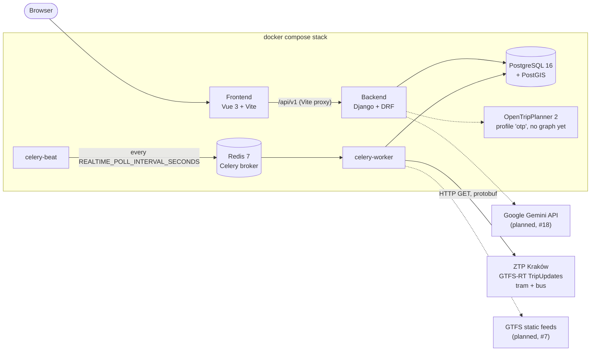
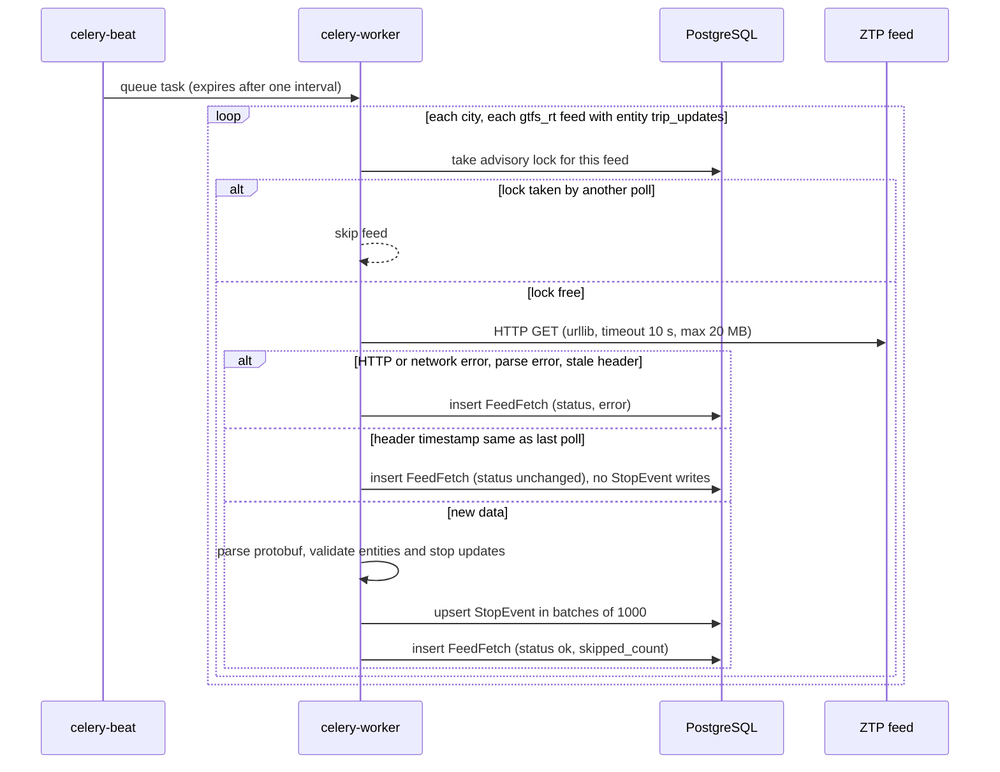

# Architecture

This page shows the services and the data flow. Items marked **(planned)** are not built yet;
the issue number is in brackets. Everything else exists in the code.

## Services

| Service | Where | Notes |
|---|---|---|
| Frontend | `frontend/` | Vue 3, TypeScript, Vite, Pinia, vue-i18n, MapLibre |
| Backend | `backend/` | Django 5, DRF, drf-spectacular. Apps: `core`, `cities`, `transit_data` |
| celery-worker, celery-beat | `backend/` image | Same image as the backend; runs background tasks |
| Redis | `redis:7-alpine` | Celery broker |
| PostgreSQL | `postgis/postgis:16-3.4` | Main database |
| OpenTripPlanner | `opentripplanner:2.6.0` | Started only with `--profile otp`; journey search is planned (#8, #12) |
| Gemini | external | Planned (#18). Behind a provider interface |
| ZTP Kraków feeds | external | Read by the realtime collector |

## Data flow

### Realtime collector (implemented, #6)

Celery beat queues `transit_data.collect_trip_updates` every `REALTIME_POLL_INTERVAL_SECONDS`
(default 30). A worker runs it once per poll.

Rules the collector follows:

- **One row per stop visit.** `StopEvent` is unique on
  `(city_id, feed_id, service_date, trip_id, stop_id, stop_sequence)`. Tram messages have no
  `stop_sequence`, so the unique key uses `NULLS NOT DISTINCT`.
- **Upsert, not append.** Each poll updates the row with the newest prediction and moves
  `last_seen`. `first_seen` is kept. An arrival or departure value is kept if a later message
  does not contain it.
- **Honest nulls.** The scheduled time is `time - delay` only when the feed gives both. Otherwise
  it is null.
- **Observed value.** The last stored value (event time not after `last_seen`) is the best
  "observed" value for statistics (#22).
- **Service date.** ZTP feeds give no `start_date`. The service date is the local date of the
  event time minus 3 hours (`service_date_inferred=True`). A trip seen in the last 4 hours keeps
  its stored date, so trips crossing 03:00 do not split. Limitation: a trip first seen after 03:00
  that started before 03:00 gets the later date.
- **Bad values skip only the affected part.** An entity or stop update with overlong ids, NUL
  bytes or out-of-range numbers or times is skipped. The count goes to `FeedFetch.skipped_count`
  and a summary to `FeedFetch.error`. One warning is logged per poll.
- **The collector does not raise.** Each feed poll ends with a `FeedFetch` row, whatever happened.
- **No overlapping polls.** A Postgres advisory lock per feed stops two polls of the same feed
  from running at once. Beat jobs expire after one interval, so queued polls do not pile up.

What the ZTP feeds contain (as observed):

| Feed | Available | Missing |
|---|---|---|
| Tram trip updates | trip id, stop id, absolute times, vehicle id | start date, route id, stop sequence, delay. No delays for trams until static GTFS (#7) |
| Bus trip updates | route id (always), delay and stop sequence (about 14–20% of updates) | Some last-stop departures come with time 0 and delay 0; they are treated as missing |

Volume: about 5,000 stop events per poll in the evening and 10,000 to 17,500 during the day.
Estimated size is about 790 bytes per row including indexes, roughly 200 MB per day.

Table bloat: daytime upserts cause table and index bloat. This is addressed in #22 (delete by
`service_date`, review the `last_seen` index, tune autovacuum).

### Journey search (planned, #8, #12)

Frontend sends `A → B` with time and preferences to the backend. The backend calls OTP
(`OTP_URL`) and returns journeys. The app has no routing code of its own; the engine is OpenTripPlanner 2
([concept](concept.md), section 1).

### Timetable (planned, #9, #10)

Static GTFS (#7) is imported into PostgreSQL. The backend serves stops, lines and stop timetables
from these tables. The frontend renders the browser and the print view.

### Live departures and vehicles (planned, #20, #21)

The realtime `StopEvent` data (#6) and vehicle positions feed the departures and live map
endpoints. Delay statistics (#22) and predictions (#23) are built on the same rows.

### Chat (planned, #18, #19)

The frontend sends a message to the backend. The backend calls Gemini through the provider
interface. Gemini answers by calling tools (journeys, timetables, tickets, live data) and the
backend returns text or cards. Rate limits apply per user.

## Retention

| Data | Rule | State |
|---|---|---|
| `StopEvent` (raw realtime) | Kept 60 days (`RAW_EVENT_RETENTION_DAYS`) | Deletion job not built yet; comes with #22 |
| `FeedFetch` (one row per poll) | About 2,880 rows per feed per day at a 30 s interval | No retention rule yet |
| Nightly statistics | Planned (#22) | Not built |

## Operating the collector

- It runs only while the local stack is up. Continuous collection needs a server (not decided).
- Status per feed: `ok`, `unchanged`, `stale`, `http_error`, `network_error`, `parse_error`,
  `error`. Check them in the Django admin (read-only views of `FeedFetch` and `StopEvent`).
- Command options are in the [README](../README.md#realtime-data-collector).
