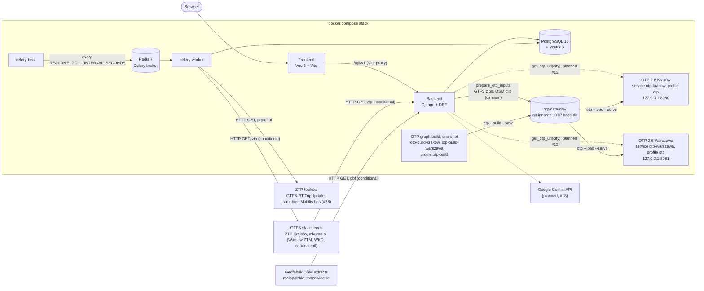
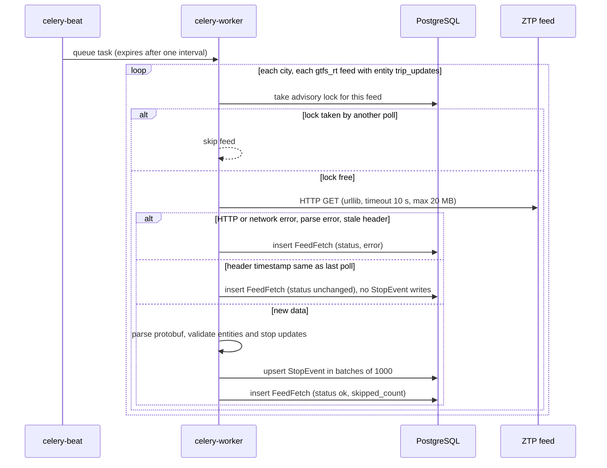
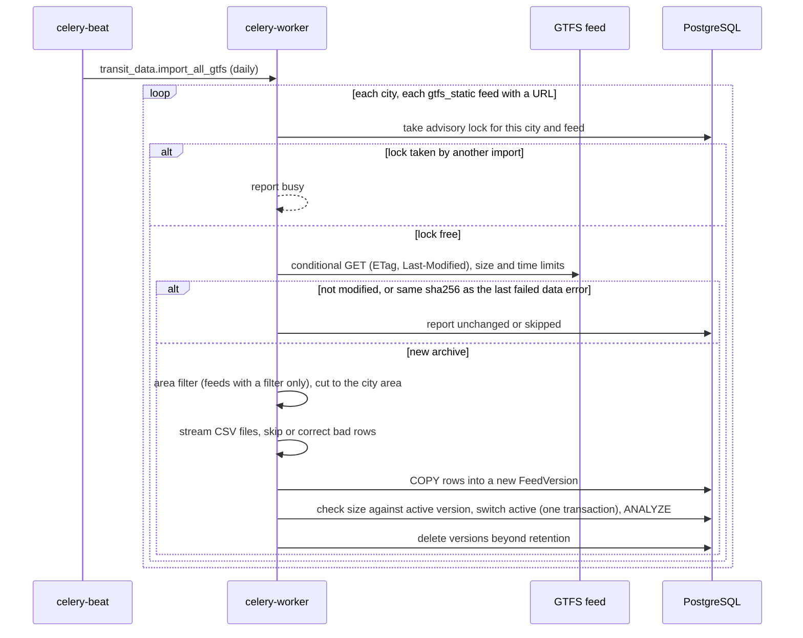
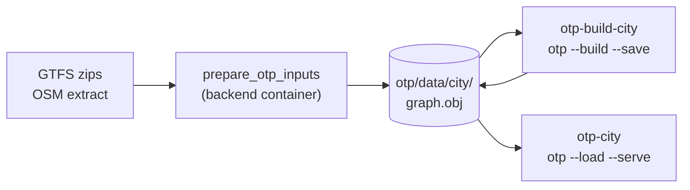

# Architecture

This page shows the services and the data flow. Items marked **(planned)** are not built yet;
the issue number is in brackets. Everything else exists in the code.

## Services

| Service | Where | Notes |
|---|---|---|
| Frontend | `frontend/` | Vue 3, TypeScript, Vite, Pinia, vue-i18n, MapLibre |
| Backend | `backend/` | Django 5, DRF, drf-spectacular. Apps: `core`, `cities`, `transit_data` |
| celery-worker, celery-beat | `backend/` image | Same image as the backend; runs background tasks |
| Redis | `redis:7-alpine` | Celery broker |
| PostgreSQL | `postgis/postgis:16-3.4` | Main database |
| OpenTripPlanner | `opentripplanner/opentripplanner:2.6.0` | One instance per city: `otp-krakow` and `otp-warszawa`, profile `otp`, bound to 127.0.0.1 on ports 8080 and 8081. Graphs are built by one-shot services (profile `otp-build`). Journey search is planned (#12) |
| OSM extracts | Geofabrik, external | Regional extracts for Małopolska and Mazowsze. `prepare_otp_inputs` clips them with `osmium-tool`, which is installed in the backend image (#8) |
| Gemini | external | Planned (#18). Behind a provider interface |
| ZTP Kraków feeds | external | Read by the realtime collector |
| GTFS static feeds | external | Imported nightly by `celery-worker` (#7). Kraków: ZTP. Warsaw: mkuran.pl (ZTM data). WKD: mkuran.pl. National rail: mkuran.pl "Polish Trains", one feed cut per city (#43) |

## Data flow

### Realtime collector (implemented, #6)

Celery beat queues `transit_data.collect_trip_updates` every `REALTIME_POLL_INTERVAL_SECONDS`
(default 30). A worker runs it once per poll.

Rules the collector follows:

- **One row per stop visit.** `StopEvent` is unique on
  `(city_id, feed_id, service_date, trip_id, stop_id, stop_sequence)`. Tram messages have no
  `stop_sequence`, so the unique key uses `NULLS NOT DISTINCT`.
- **Upsert, not append.** Each poll updates the row with the newest prediction and moves
  `last_seen`. `first_seen` is kept. An arrival or departure value is kept if a later message
  does not contain it.
- **Honest nulls.** The scheduled time is `time - delay` only when the feed gives both. Otherwise
  it is null.
- **Observed value.** The last stored value (event time not after `last_seen`) is the best
  "observed" value for statistics (#22).
- **Service date.** ZTP feeds give no `start_date`. The service date is the local date of the
  event time minus 3 hours (`service_date_inferred=True`). A trip seen in the last 4 hours keeps
  its stored date, so trips crossing 03:00 do not split. Limitation: a trip first seen after 03:00
  that started before 03:00 gets the later date.
- **Bad values skip only the affected part.** An entity or stop update with overlong ids, NUL
  bytes or out-of-range numbers or times is skipped. The count goes to `FeedFetch.skipped_count`
  and a summary to `FeedFetch.error`. One warning is logged per poll.
- **The collector does not raise.** Each feed poll ends with a `FeedFetch` row, whatever happened.
- **No overlapping polls.** A Postgres advisory lock per feed stops two polls of the same feed
  from running at once. Beat jobs expire after one interval, so queued polls do not pile up.

What the ZTP feeds contain (as observed):

| Feed | Available | Missing |
|---|---|---|
| Tram trip updates | trip id, stop id, absolute times, vehicle id | start date, route id, stop sequence, delay. The static import (#7) is in place, but the collector does not read it yet |
| Bus trip updates | route id (always), delay and stop sequence (about 14–20% of updates) | Some last-stop departures come with time 0 and delay 0; they are treated as missing |

Volume: about 5,000 stop events per poll in the evening and 10,000 to 17,500 during the day.
Estimated size is about 790 bytes per row including indexes, roughly 200 MB per day.

Table bloat: daytime upserts cause table and index bloat. This is addressed in #22 (delete by
`service_date`, review the `last_seen` index, tune autovacuum).

### Static GTFS import (implemented, #7)

Celery beat runs `transit_data.import_all_gtfs` every day at `GTFS_IMPORT_HOUR`:`GTFS_IMPORT_MINUTE`
(default 03:30, Europe/Warsaw). It imports every `gtfs_static` feed that has a URL in each city config.
The same import runs by hand with `manage.py import_gtfs <city>`.

Rules the importer follows:

- **Versioned.** Every import writes a new `FeedVersion`. The active version is switched only after
  the whole load succeeds. Readers never see a half-loaded feed.
- **Retention.** Per feed: the active version, one superseded version, and the last 5 failed
  versions (failed rows hold no data). Settings: `TRANSIT_GTFS_KEEP_SUPERSEDED`, `TRANSIT_GTFS_KEEP_FAILED`.
- **Retry.** A failure caused by a data error (`GtfsFormatError`, `FeedRejected`) is remembered by
  sha256, and the same archive is not imported again until it changes. Any other failure (interrupted run,
  database error, time limit) is retried on the next run.
- **Size check.** A new version with less than 50% of the active trips or stop times is rejected
  (`TRANSIT_GTFS_MIN_SHARE_OF_ACTIVE`). `--force` bypasses the check. Only a log warning is written
  for a rejected version.
- **Bad rows.** Rows with bad references or values are skipped and counted, with reasons, in the
  import report. Stop hierarchy errors (bad parent links) are corrected; stop times on stations are
  skipped. A feed is rejected when more than 5% of rows are skipped (`TRANSIT_GTFS_MAX_SKIPPED_RATIO`).
- **Expiry warning.** The report warns when service ends within 14 days (`TRANSIT_GTFS_EXPIRY_WARNING_DAYS`).
- **Report.** Each run stores counts, skipped rows, corrections, ignored files and a comparison with
  the active version as JSON on `FeedVersion.report`.
- **Times.** Stored as seconds since midnight of the service day. Values above 24:00 are allowed.
- **Area filter (optional, per feed).** A `gtfs_static` feed can have a `filter` in its city config:
  `bbox` (`[min_lon, min_lat, max_lon, max_lat]`) and optional `exclude_agencies` (agency ids).
  - A trip is kept only if at least two of its calls are inside the box. Kept trips are cut to their
    inside calls; the first and last calls are always timed. Headsigns are not changed.
  - A trip that leaves and re-enters the box is joined directly between its inside calls.
  - Unused routes, agencies, services and shapes are dropped. Shapes are clipped by
    `shape_dist_traveled`. `agency.txt` is kept whole for single-agency feeds.
  - The output is deterministic.
  - Changing a `filter` forces a re-import. If the filter fails or leaves no data, the version is
    failed and the active version stays.
- **Calendar.** `calendar.txt` is optional when `calendar_dates.txt` exists.

Measured on the real feeds during #7 testing (local stack):

| Feed | Stops | Trips | Stop times | Import time |
|---|---|---|---|---|
| Kraków tram (`ztp_tram`) | 355 | 15,321 | 439,544 | 4.2 s |
| Kraków bus (`ztp_bus`) | 2,983 | 85,907 | 1,833,889 | about 21–25 s |
| Warsaw ZTM (`ztm`) | 7,270 | 259,591 | 7,446,307 | 73–87 s |
| WKD (`wkd`) | 60 | 3,702 | 55,386 | 1.4 s |

About 90,000 stop times per second, 210 MB peak memory. The database was about 3.5 GB with the
active and one previous version of all feeds. A departures query for one stop on one date took
6.9 ms; a trigram name search took 0.4 ms (measured on the same data).

National rail (`rail`, one feed, cut per city, measured on the real feed in #43):

| City | Stops | Routes | Trips | Agencies | Import time |
|---|---|---|---|---|---|
| Kraków | 248 | 30 | 1,721 | 4 (KML, PR, IC, KS) | about 11 s |
| Warsaw | 447 | 42 | 8,412 | no SKM (SKM is in `ztm`) | not recorded |

Re-import gives the same result.

Limits (not built yet): no check for times on the first or last stop, and no check that times rise
monotonically. The importer does not keep the zip files; the OTP inputs step (#8) downloads its own
copies (see below).

### OpenTripPlanner graphs (implemented, #8)

OTP 2 serves one graph per instance, so each city has its own OTP service and graph
([decision 14](decisions.md#14-one-opentripplanner-instance-per-city)). A graph is made in three steps:

1. **Prepare inputs.** `manage.py prepare_otp_inputs --city <city>` runs in the backend container.
   It downloads the city's `gtfs_static` feeds that have a URL and the Geofabrik regional OSM extract.
   A feed with a `filter` is cut to the city's area (see Static GTFS import), so national rail is
   part of the graph once the graph is rebuilt (#43). It clips the extract with
   `osmium extract --strategy complete_ways` to the bbox of all GTFS stops plus 3 km
   ([decision 15](decisions.md#15-clip-the-osm-extract-with-the-osmium-tool-cli-in-the-backend-image)).
   It writes the city's OTP config and `prepare-report.json`.
2. **Build.** The one-shot service `otp-build-<city>` runs `otp --build --save` and writes `graph.obj`.
3. **Serve.** The service `otp-<city>` runs `otp --load --serve`. Health: `GET /otp/actuators/health`.
   GTFS GraphQL: `POST /otp/gtfs/v1`.

Rules the steps follow:

- **Config layout.** `otp/config/` holds the shared, committed config (build, router and OTP
  config). `otp/<city>/` is an optional committed override, deep-merged over it. Lists are replaced,
  not merged. The generated config for a city is written to `otp/data/<city>/`.
- **City-specific values** come from the city config and are added by `prepare_otp_inputs`: feed
  files, the OSM file and the time zone. Nothing city-specific is written by hand in `otp/config/`.
- **OTP data directory.** `otp/data/<city>/` is the OTP base directory. It is git-ignored.
  Each prepare and build overwrites its files.
- **City config section.** New internal section `otp` in `backend/cities/config/<id>.yaml`:
  `osm_url` (https, required) and `bbox` (`[min_lon, min_lat, max_lon, max_lat]`, optional; `null`
  means absent). It is never returned by the API.
- **Filtered feeds.** For a feed with a `filter`, the prepare keeps the source zip and its metadata
  (`cache/<id>.source.gtfs.zip`, `cache/<id>.source.json`) and writes the cut zip as `<id>.gtfs.zip`.
  `cache/<id>.filter.json` is the stamp for the filter. Removing a `filter` cleans up these files
  and downloads the full feed again. The unpacked-size limit applies on both the import and the OTP path.
- **Downloads** are conditional. A failed download keeps the previous file. GTFS uses
  `TRANSIT_GTFS_MAX_BYTES` and `TRANSIT_GTFS_DOWNLOAD_MAX_SECONDS`. The OSM extract uses
  `OTP_OSM_MAX_BYTES` and `OTP_OSM_DOWNLOAD_MAX_SECONDS`.
- **One run per city.** A per-city lock (`cache/prepare.lock`) stops two prepares from running at once.
- **Warnings, not errors.** A clip bbox wider than 2 degrees on either axis, or outside the bounds of
  the extract, is written as a warning to the output and to `prepare-report.json`. A single bad stop
  can widen the bbox and the build heap needed; the warning shows it.
- **Mounts.** The backend mounts `./otp` at `/otp` read-write. The celery worker and beat mount it
  read-only.
- **Backend access.** `cities.registry.get_otp_url(city)` returns the URL from `OTP_URL_KRAKOW` or
  `OTP_URL_WARSZAWA`. No backend code calls OTP yet; the journeys endpoint is #12.

Measured on 2026-11-14 (Docker with 12 GB, 8 CPUs, OTP 2.6):

| City | Prepare | Build | Build heap (peak RSS) | `graph.obj` | Serve heap (RSS) | OSM extract |
|---|---|---|---|---|---|---|
| Kraków | 34–40 s | 4–5.5 min | `-Xmx4G` (3.5 GB) | 122 MB | `-Xmx2G` (1 GB) | 204 → 72 MB |
| Warsaw | 2 min 13 s | 8 min 21 s | `-Xmx7G` (7.4 GB) | 244 MB | `-Xmx3G` (1.8 GB) | 302 → 134 MB |

Settings (defaults in the table; the OTP URLs are set in `.env.example`). An empty
`OTP_OSMIUM_BIN` or `OTP_BBOX_BUFFER_KM` uses the default:

| Setting | Default | Meaning |
|---|---|---|
| `OTP_URL_KRAKOW`, `OTP_URL_WARSZAWA` | see `.env.example` | Base URL of each instance, as the backend sees it. Replaces the old `OTP_URL` |
| `OTP_DATA_DIR` | `<repo>/otp/data` (`/otp/data` in the container) | Root of the per-city data directories |
| `OTP_CONFIG_DIR` | `<repo>/otp` (`/otp` in the container) | Root of the shared config and overrides |
| `OTP_OSMIUM_BIN` | `osmium` | `osmium-tool` binary |
| `OTP_BBOX_BUFFER_KM` | `3` | Buffer around the GTFS stops. Must be finite and at least 0; otherwise the backend fails at startup (`ImproperlyConfigured`) |
| `OTP_OSM_MAX_BYTES` | 2 GB | Size limit for the OSM download |
| `OTP_OSM_DOWNLOAD_MAX_SECONDS` | `1800` | Time limit for the OSM download |
| `OTP_KRAKOW_BUILD_JAVA_OPTS`, `OTP_WARSZAWA_BUILD_JAVA_OPTS` | `-Xmx4G`, `-Xmx7G` | JVM options for the build |
| `OTP_KRAKOW_SERVE_JAVA_OPTS`, `OTP_WARSZAWA_SERVE_JAVA_OPTS` | `-Xmx2G`, `-Xmx3G` | JVM options for the server |
| `OTP_KRAKOW_PORT`, `OTP_WARSZAWA_PORT` | `8080`, `8081` | Host ports, bound to 127.0.0.1 |

Build and run commands are in the [README](../README.md#opentripplanner-graphs).
The rules for the input files, failure cases and the lock file are in
[`otp/README.md`](../otp/README.md).

### Journey search (planned, #12)

Frontend sends `A → B` with time and preferences to the backend. The backend calls the OTP
instance of the city and returns journeys. The app has no routing code of its own; the engine is
OpenTripPlanner 2 ([concept](concept.md), section 1).

### Timetable (planned, #9, #10)

The static import (#7, see above) already fills the PostgreSQL tables. The backend will serve stops,
lines and stop timetables from these tables. The frontend will render the browser and the print view.

### Live departures and vehicles (planned, #20, #21)

The realtime `StopEvent` data (#6) and vehicle positions feed the departures and live map
endpoints. Delay statistics (#22) and predictions (#23) are built on the same rows.

### Chat (planned, #18, #19)

The frontend sends a message to the backend. The backend calls Gemini through the provider
interface. Gemini answers by calling tools (journeys, timetables, tickets, live data) and the
backend returns text or cards. Rate limits apply per user.

## Retention

| Data | Rule | State |
|---|---|---|
| `StopEvent` (raw realtime) | Kept 60 days (`RAW_EVENT_RETENTION_DAYS`) | Deletion job not built yet; comes with #22 |
| `FeedFetch` (one row per poll) | About 2,880 rows per feed per day at a 30 s interval | No retention rule yet |
| Static GTFS versions (`FeedVersion` and its rows) | Active, one superseded, last 5 failed versions per feed (see above) | Built (#7) |
| OTP inputs and graph (`otp/data/<city>/`: GTFS zips, clipped and unclipped OSM extract, `graph.obj`, and `cache/` with source and cut zips of feeds with a `filter`) | Overwritten by each prepare and build; no history | Built (#8, filtered feeds #43). Git-ignored |
| Nightly statistics | Planned (#22) | Not built |

## Operating the collector

- It runs only while the local stack is up. Continuous collection needs a server (not decided).
- Status per feed: `ok`, `unchanged`, `stale`, `http_error`, `network_error`, `parse_error`,
  `error`. Check them in the Django admin (read-only views of `FeedFetch` and `StopEvent`).
- Command options are in the [README](../README.md#realtime-data-collector).

## Operating the static import

- Run it by hand: `manage.py import_gtfs <city> [--feed <id>] [--force] [--file <zip or dir>]`. `--file` requires `--feed`.
  Exit status is 1 when a feed failed. Unchanged, busy and skipped feeds are not errors.
- The admin shows the static tables read-only. Rows are written and deleted only by the importer.
- Warsaw (`ztm`, `wkd`) feeds expire. The WKD feed data ends around 2026-12-12; the expiry
  warning appears 14 days before the end of service.
- Warsaw uses the mkuran.pl feed. A single maintainer runs it; the official ZTM feed is the fallback
  (see `docs/decisions.md`, entry 12).
- National rail (`rail`) is one feed for both cities. Each city has its own `filter`. The feed covers
  30 days and mkuran.pl rebuilds it daily. Load it with `manage.py import_gtfs <city> --feed rail`
  (see `docs/decisions.md`, entry 18).

## Operating the OTP graphs

- Rebuild by hand after a feed changes: `make otp-build CITY=<city>` (see the
  [README](../README.md#opentripplanner-graphs)). The rebuild is not scheduled yet
  ([decision 17](decisions.md#17-graph-rebuild-is-manual-for-now)).
- The `make` build target restarts the city's service if it is running. While it restarts, that
  city's OTP does not answer.
- Graphs built before the rail feed was added have no national rail. Rebuild each city to include it.
  Build time and memory with rail are not measured yet (#51).
- Measured peak memory: Warsaw build 7.4 GB RSS, Kraków build 3.5 GB RSS. Docker was given 12 GB.
- The bicycle transfers are left out on purpose ([decision 16](decisions.md#16-no-bicycle-transfers-in-the-transfer-pre-computation)).
- Each prepare writes `prepare-report.json` in `otp/data/<city>/`. Check its warnings after a
  feed or extract change.
