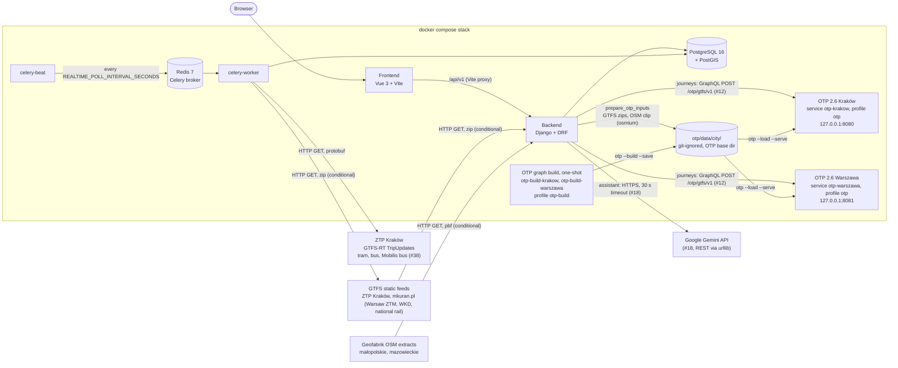
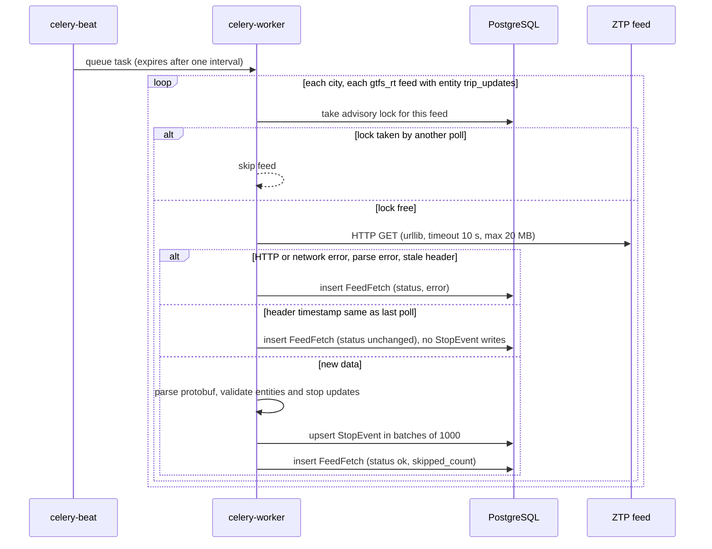
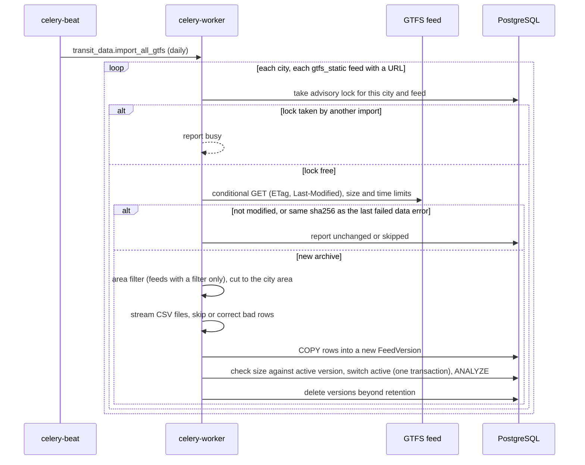
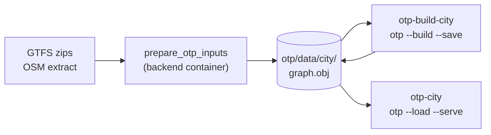
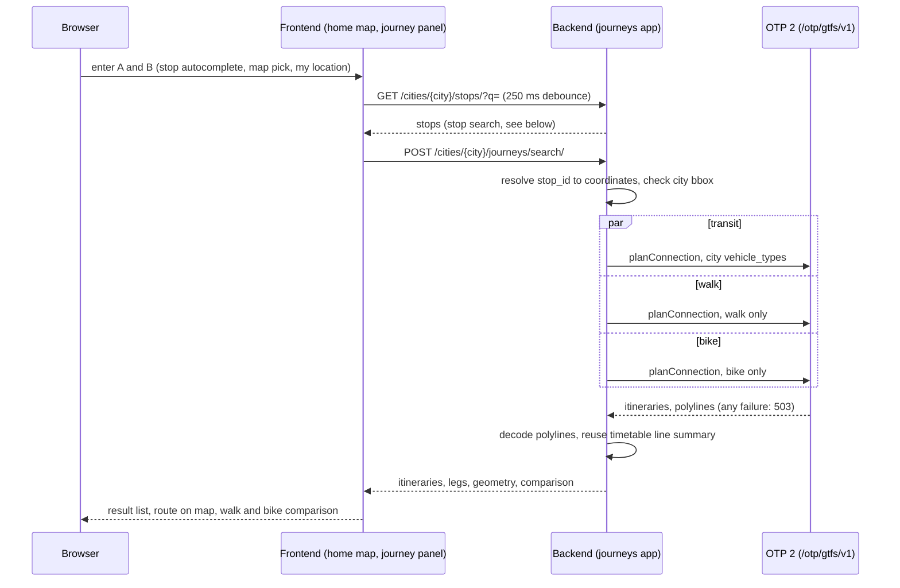
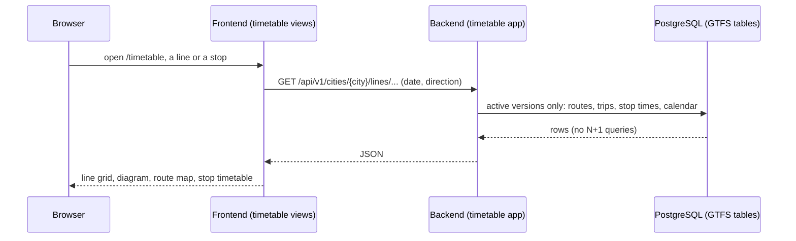
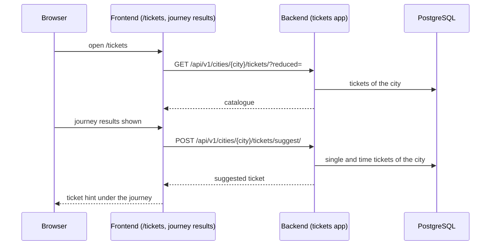
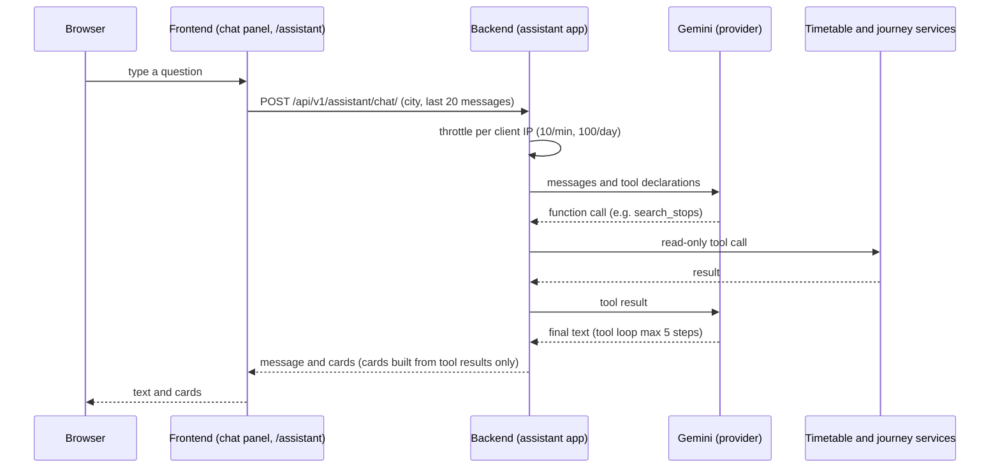

# Architecture

This page shows the services and the data flow. Items marked **(planned)** are not built yet;
the issue number is in brackets. Everything else exists in the code.

## Services



| Service | Where | Notes |
|---|---|---|
| Frontend | `frontend/` | Vue 3, TypeScript, Vite, Pinia, vue-i18n, MapLibre |
| Backend | `backend/` | Django 5, DRF, drf-spectacular. Apps: `core`, `cities`, `transit_data`, `timetable`, `journeys`, `assistant`, `tickets` |
| celery-worker, celery-beat | `backend/` image | Same image as the backend; runs background tasks |
| Redis | `redis:7-alpine` | Celery broker |
| PostgreSQL | `postgis/postgis:16-3.4` | Main database |
| OpenTripPlanner | `opentripplanner/opentripplanner:2.6.0` | One instance per city: `otp-krakow` and `otp-warszawa`, profile `otp`, bound to 127.0.0.1 on ports 8080 and 8081. Graphs are built by one-shot services (profile `otp-build`). Journey search calls it through GraphQL (#12) |
| OSM extracts | Geofabrik, external | Regional extracts for Małopolska and Mazowsze. `prepare_otp_inputs` clips them with `osmium-tool`, which is installed in the backend image (#8) |
| Gemini | external | Used by the `assistant` app (#18). Behind a provider interface; REST over `urllib`, no SDK. Model from `GEMINI_MODEL` (default `gemini-flash-latest`), key from `GEMINI_API_KEY` |
| ZTP Kraków feeds | external | Read by the realtime collector |
| GTFS static feeds | external | Imported nightly by `celery-worker` (#7). Kraków: ZTP. Warsaw: mkuran.pl (ZTM data). WKD: mkuran.pl. National rail: mkuran.pl "Polish Trains", one feed cut per city (#43) |

## Data flow

### Realtime collector (implemented, #6)

Celery beat queues `transit_data.collect_trip_updates` every `REALTIME_POLL_INTERVAL_SECONDS`
(default 30). A worker runs it once per poll.



Rules the collector follows:

- **One row per stop visit.** `StopEvent` is unique on
  `(city_id, feed_id, service_date, trip_id, stop_id, stop_sequence)`. Tram messages have no
  `stop_sequence`, so the unique key uses `NULLS NOT DISTINCT`.
- **Upsert, not append.** Each poll updates the row with the newest prediction and moves
  `last_seen`. `first_seen` is kept. An arrival or departure value is kept if a later message
  does not contain it.
- **Honest nulls.** The scheduled time is `time - delay` only when the feed gives both. Otherwise
  it is null.
- **Observed value.** The last stored value (event time not after `last_seen`) is the best
  "observed" value for statistics (#22).
- **Service date.** ZTP feeds give no `start_date`. The service date is the local date of the
  event time minus 3 hours (`service_date_inferred=True`). A trip seen in the last 4 hours keeps
  its stored date, so trips crossing 03:00 do not split. Limitation: a trip first seen after 03:00
  that started before 03:00 gets the later date.
- **Bad values skip only the affected part.** An entity or stop update with overlong ids, NUL
  bytes or out-of-range numbers or times is skipped. The count goes to `FeedFetch.skipped_count`
  and a summary to `FeedFetch.error`. One warning is logged per poll.
- **The collector does not raise.** Each feed poll ends with a `FeedFetch` row, whatever happened.
- **No overlapping polls.** A Postgres advisory lock per feed stops two polls of the same feed
  from running at once. Beat jobs expire after one interval, so queued polls do not pile up.

What the ZTP feeds contain (as observed):

| Feed | Available | Missing |
|---|---|---|
| Tram trip updates | trip id, stop id, absolute times, vehicle id | start date, route id, stop sequence, delay. The static import (#7) is in place; the collector does not read it, but the departures board joins the two at request time (#73) |
| Bus trip updates | route id (always), delay and stop sequence (about 14–20% of updates) | Some last-stop departures come with time 0 and delay 0; they are treated as missing |

Volume: about 5,000 stop events per poll in the evening and 10,000 to 17,500 during the day.
Estimated size is about 790 bytes per row including indexes, roughly 200 MB per day.

Table bloat: daytime upserts cause table and index bloat. This is addressed in #22 (delete by
`service_date`, review the `last_seen` index, tune autovacuum).

### Static GTFS import (implemented, #7)

Celery beat runs `transit_data.import_all_gtfs` every day at `GTFS_IMPORT_HOUR`:`GTFS_IMPORT_MINUTE`
(default 03:30, Europe/Warsaw). It imports every `gtfs_static` feed that has a URL in each city config.
The same import runs by hand with `manage.py import_gtfs <city>`.



Rules the importer follows:

- **Versioned.** Every import writes a new `FeedVersion`. The active version is switched only after
  the whole load succeeds. Readers never see a half-loaded feed.
- **Retention.** Per feed: the active version, one superseded version, and the last 5 failed
  versions (failed rows hold no data). Settings: `TRANSIT_GTFS_KEEP_SUPERSEDED`, `TRANSIT_GTFS_KEEP_FAILED`.
- **Retry.** A failure caused by a data error (`GtfsFormatError`, `FeedRejected`) is remembered by
  sha256, and the same archive is not imported again until it changes. Any other failure (interrupted run,
  database error, time limit) is retried on the next run.
- **Size check.** A new version with less than 50% of the active trips or stop times is rejected
  (`TRANSIT_GTFS_MIN_SHARE_OF_ACTIVE`). `--force` bypasses the check. Only a log warning is written
  for a rejected version.
- **Bad rows.** Rows with bad references or values are skipped and counted, with reasons, in the
  import report. Stop hierarchy errors (bad parent links) are corrected; stop times on stations are
  skipped. A feed is rejected when more than 5% of rows are skipped (`TRANSIT_GTFS_MAX_SKIPPED_RATIO`).
- **Expiry warning.** The report warns when service ends within 14 days (`TRANSIT_GTFS_EXPIRY_WARNING_DAYS`).
- **Report.** Each run stores counts, skipped rows, corrections, ignored files and a comparison with
  the active version as JSON on `FeedVersion.report`.
- **Times.** Stored as seconds since midnight of the service day. Values above 24:00 are allowed.
- **Area filter (optional, per feed).** A `gtfs_static` feed can have a `filter` in its city config:
  `bbox` (`[min_lon, min_lat, max_lon, max_lat]`) and optional `exclude_agencies` (agency ids).
  - A trip is kept only if at least two of its calls are inside the box. Kept trips are cut to their
    inside calls; the first and last calls are always timed. Headsigns are not changed.
  - A trip that leaves and re-enters the box is joined directly between its inside calls.
  - Unused routes, agencies, services and shapes are dropped. Shapes are clipped by
    `shape_dist_traveled`. `agency.txt` is kept whole for single-agency feeds.
  - The output is deterministic.
  - Changing a `filter` forces a re-import. If the filter fails or leaves no data, the version is
    failed and the active version stays.
- **Calendar.** `calendar.txt` is optional when `calendar_dates.txt` exists.

Measured on the real feeds during #7 testing (local stack):

| Feed | Stops | Trips | Stop times | Import time |
|---|---|---|---|---|
| Kraków tram (`ztp_tram`) | 355 | 15,321 | 439,544 | 4.2 s |
| Kraków bus (`ztp_bus`) | 2,983 | 85,907 | 1,833,889 | about 21–25 s |
| Warsaw ZTM (`ztm`) | 7,270 | 259,591 | 7,446,307 | 73–87 s |
| WKD (`wkd`) | 60 | 3,702 | 55,386 | 1.4 s |

About 90,000 stop times per second, 210 MB peak memory. The database was about 3.5 GB with the
active and one previous version of all feeds. A departures query for one stop on one date took
6.9 ms; a trigram name search took 0.4 ms (measured on the same data).

National rail (`rail`, one feed, cut per city, measured on the real feed in #43):

| City | Stops | Routes | Trips | Agencies | Import time |
|---|---|---|---|---|---|
| Kraków | 248 | 30 | 1,721 | 4 (KML, PR, IC, KS) | about 11 s |
| Warsaw | 447 | 42 | 8,412 | no SKM (SKM is in `ztm`) | not recorded |

Re-import gives the same result.

Limits (not built yet): no check for times on the first or last stop, and no check that times rise
monotonically. The importer does not keep the zip files; the OTP inputs step (#8) downloads its own
copies (see below).

### OpenTripPlanner graphs (implemented, #8)

OTP 2 serves one graph per instance, so each city has its own OTP service and graph
([decision 14](decisions.md#14-one-opentripplanner-instance-per-city)). A graph is made in three steps:

1. **Prepare inputs.** `manage.py prepare_otp_inputs --city <city>` runs in the backend container.
   It downloads the city's `gtfs_static` feeds that have a URL and the Geofabrik regional OSM extract.
   A feed with a `filter` is cut to the city's area (see Static GTFS import), so national rail is
   part of the graph once the graph is rebuilt (#43). It clips the extract with
   `osmium extract --strategy complete_ways` to the bbox of all GTFS stops plus 3 km
   ([decision 15](decisions.md#15-clip-the-osm-extract-with-the-osmium-tool-cli-in-the-backend-image)).
   It writes the city's OTP config and `prepare-report.json`.
2. **Build.** The one-shot service `otp-build-<city>` runs `otp --build --save` and writes `graph.obj`.
3. **Serve.** The service `otp-<city>` runs `otp --load --serve`. Health: `GET /otp/actuators/health`.
   GTFS GraphQL: `POST /otp/gtfs/v1`.



Rules the steps follow:

- **Config layout.** `otp/config/` holds the shared, committed config (build, router and OTP
  config). `otp/<city>/` is an optional committed override, deep-merged over it. Lists are replaced,
  not merged. The generated config for a city is written to `otp/data/<city>/`.
- **City-specific values** come from the city config and are added by `prepare_otp_inputs`: feed
  files, the OSM file and the time zone. Nothing city-specific is written by hand in `otp/config/`.
- **OTP data directory.** `otp/data/<city>/` is the OTP base directory. It is git-ignored.
  Each prepare and build overwrites its files.
- **City config section.** New internal section `otp` in `backend/cities/config/<id>.yaml`:
  `osm_url` (https, required) and `bbox` (`[min_lon, min_lat, max_lon, max_lat]`, optional; `null`
  means absent). It is never returned by the API.
- **Filtered feeds.** For a feed with a `filter`, the prepare keeps the source zip and its metadata
  (`cache/<id>.source.gtfs.zip`, `cache/<id>.source.json`) and writes the cut zip as `<id>.gtfs.zip`.
  `cache/<id>.filter.json` is the stamp for the filter. Removing a `filter` cleans up these files
  and downloads the full feed again. The unpacked-size limit applies on both the import and the OTP path.
- **Downloads** are conditional. A failed download keeps the previous file. GTFS uses
  `TRANSIT_GTFS_MAX_BYTES` and `TRANSIT_GTFS_DOWNLOAD_MAX_SECONDS`. The OSM extract uses
  `OTP_OSM_MAX_BYTES` and `OTP_OSM_DOWNLOAD_MAX_SECONDS`.
- **One run per city.** A per-city lock (`cache/prepare.lock`) stops two prepares from running at once.
- **Warnings, not errors.** A clip bbox wider than 2 degrees on either axis, or outside the bounds of
  the extract, is written as a warning to the output and to `prepare-report.json`. A single bad stop
  can widen the bbox and the build heap needed; the warning shows it.
- **Mounts.** The backend mounts `./otp` at `/otp` read-write. The celery worker and beat mount it
  read-only.
- **Backend access.** `cities.registry.get_otp_url(city)` returns the URL from `OTP_URL_KRAKOW` or
  `OTP_URL_WARSZAWA`. Only the `journeys` app calls OTP, through that URL (#12).

Measured on 2026-11-14 (Docker with 12 GB, 8 CPUs, OTP 2.6):

| City | Prepare | Build | Build heap (peak RSS) | `graph.obj` | Serve heap (RSS) | OSM extract |
|---|---|---|---|---|---|---|
| Kraków | 34–40 s | 4–5.5 min | `-Xmx4G` (3.5 GB) | 122 MB | `-Xmx2G` (1 GB) | 204 → 72 MB |
| Warsaw | 2 min 13 s | 8 min 21 s | `-Xmx7G` (7.4 GB) | 244 MB | `-Xmx3G` (1.8 GB) | 302 → 134 MB |

Settings (defaults in the table; the OTP URLs are set in `.env.example`). An empty
`OTP_OSMIUM_BIN` or `OTP_BBOX_BUFFER_KM` uses the default:

| Setting | Default | Meaning |
|---|---|---|
| `OTP_URL_KRAKOW`, `OTP_URL_WARSZAWA` | see `.env.example` | Base URL of each instance, as the backend sees it. Replaces the old `OTP_URL` |
| `OTP_DATA_DIR` | `<repo>/otp/data` (`/otp/data` in the container) | Root of the per-city data directories |
| `OTP_CONFIG_DIR` | `<repo>/otp` (`/otp` in the container) | Root of the shared config and overrides |
| `OTP_OSMIUM_BIN` | `osmium` | `osmium-tool` binary |
| `OTP_BBOX_BUFFER_KM` | `3` | Buffer around the GTFS stops. Must be finite and at least 0; otherwise the backend fails at startup (`ImproperlyConfigured`) |
| `OTP_OSM_MAX_BYTES` | 2 GB | Size limit for the OSM download |
| `OTP_OSM_DOWNLOAD_MAX_SECONDS` | `1800` | Time limit for the OSM download |
| `OTP_KRAKOW_BUILD_JAVA_OPTS`, `OTP_WARSZAWA_BUILD_JAVA_OPTS` | `-Xmx4G`, `-Xmx7G` | JVM options for the build |
| `OTP_KRAKOW_SERVE_JAVA_OPTS`, `OTP_WARSZAWA_SERVE_JAVA_OPTS` | `-Xmx2G`, `-Xmx3G` | JVM options for the server |
| `OTP_KRAKOW_PORT`, `OTP_WARSZAWA_PORT` | `8080`, `8081` | Host ports, bound to 127.0.0.1 |

Build and run commands are in the [README](../README.md#opentripplanner-graphs).
The rules for the input files, failure cases and the lock file are in
[`otp/README.md`](../otp/README.md).

### Journey search (implemented, #12, #13)

The frontend sends `A → B` with time and preferences to the backend. The `journeys` Django app calls the
OTP instance of the city and returns up to 5 itineraries. The app has no routing code of its own; the engine
is OpenTripPlanner 2 ([concept](concept.md), section 1). Contract: [api.md](api.md#journeys-12-and-stop-search-59).



Rules the app follows:

- **OTP client.** `journeys/otp.py` uses Python's `urllib` (no GraphQL library) to POST to
  `OTP_URL_<CITY>/otp/gtfs/v1`. The timeout is `OTP_TIMEOUT_SECONDS` (10 s). Any failure returns `503`
  `journey_planner_unavailable`; OTP's errors are never sent to the client.
- **Parallel queries.** `services.py` runs the transit, walk and bike `planConnection` queries in parallel.
  The walk and bike results make up `comparison`. It is `null` when OTP finds no route or the route takes more
  than `JOURNEY_COMPARISON_MAX_DURATION` (3 h).
- **Modes** are limited to the city's `vehicle_types`.
- **Bounding box.** Points outside the city's box are rejected with `400`. The box is the city's `otp.bbox`, or
  the extent of the stops plus a buffer.
- **Preferences.** `fewer_transfers` sets `JOURNEY_FEWER_TRANSFERS_COST` (900). `less_walking` sets the walk
  reluctance to `JOURNEY_LESS_WALKING_RELUCTANCE` (5.0). `wheelchair` prefers accessible trips and stops; it
  does not exclude the others (the OTP router config sets `onlyConsiderAccessible` to false). See
  [decision 30](decisions.md#30-wheelchair-is-a-preference-not-a-filter).
- **Geometry.** OTP's polylines are decoded in `polyline.py` to GeoJSON `[lon, lat]` coordinates.
- **Line summary.** Each transit leg reuses the timetable line summary, so its ids link to the timetable.
- **Frontend** (#13). The home route `/` is a full-screen map with a floating panel on desktop, and a top panel
  with a bottom tab bar on phones. `/journey` redirects to `/`. The tab bar also links to Tickets (`/tickets`)
  and the assistant page. The Pinia store keeps the search across navigation. Times use the city's timezone offset.
  Errors are shown for `503`, `429`, network failures and `400`.
- **Not in the MVP.** Address geocoding: from and to are stops, map points or my location
  ([decision 31](decisions.md#31-no-address-geocoding-in-the-mvp)).

### Stop search (implemented, #59)

`GET /api/v1/cities/{city}/stops/?q=` is in `backend/timetable/stops.py`. It is used by the journey form.

- **Matching is in memory.** Names are compared without diacritics (`ł` is folded to `l`), and word-prefix
  matches rank first. No PostgreSQL extension is used.
- **Grouping.** Platforms with the same name within 300 m are one result. At most 20 results.
- **Cache.** The stop list is cached for 24 h, keyed by the active feed versions, so a new import starts a new
  entry. Redis is not yet the Django cache backend (follow-up, devops).
- **Data check.** On real Warsaw data, stop names carry no platform codes, so grouping by name works.
- Decision: [decision 29](decisions.md#29-stop-search-is-in-memory-with-diacritics-folding).

### Timetable browser (implemented, #10, #11)

The `timetable` Django app is read-only. It reads the tables filled by the static import (#7) and
only the **active** `FeedVersion` of each feed. It has no Celery tasks and writes nothing. The frontend
timetable views call its four endpoints ([api.md](api.md#timetable-10)).



Rules the app follows:

- **Ids** are `{feed_id}:{gtfs_id}`, stable across re-imports of the same feed.
- **Line groups** come from the internal `line_group_rules` in each city config (vehicle type, feed,
  short-name regex). First match wins; no match goes to the first group.
- **Day types** are `weekday`, `saturday` and `sunday`. A holiday counts as `sunday` when its set of
  active services equals the nearest Sunday's set. No holiday list is hard-coded.
- **Transfers** (other lines at the same stop or a stop with the same name within 300 m) are cached for
  24 h in the Django cache, keyed by stop row id. A new import creates new ids, so old entries are not reused.
- **Frequency trips** (`frequencies.txt`) are expanded into one departure per headway. The trip view
  shows the template trip's times.
- **Measured** on real Kraków and Warsaw data: 20–110 ms per request, no N+1 queries.

Frontend routes: `/timetable`, `/timetable/lines/:lineId`, `/timetable/lines/:lineId/stops/:stopId`.
The city is not in the URL. Maps use MapLibre with its worker set explicitly (see
[decisions](decisions.md#26-maplibre-worker-url-set-explicitly)).

The stop page with the departures board is built (#73, see [Live departures](#live-departures-implemented-73-74)).
The lines at a stop are built too (#9, #56, see [Stop overview](#stop-overview-implemented-9-56)).

### Live departures (implemented, #73, #74)

`GET /api/v1/cities/{city}/stops/{stop_id}/departures/` is in `backend/timetable/departures.py`. It joins
the static timetable (#7) with the realtime `StopEvent` rows (#6). Contract: [api.md](api.md#departures-73).

```mermaid
sequenceDiagram
    participant U as Browser
    participant F as Frontend (stop departures board)
    participant B as Backend (timetable app)
    participant P as PostgreSQL (GTFS tables, StopEvent)

    U->>F: open /timetable/stops/:stopId
    loop 30 s after the previous response, paused when the tab is hidden
        F->>B: GET .../stops/{stop_id}/departures/?limit=
        B->>P: active versions: scheduled calls of the stop group
        B->>P: StopEvent rows seen in the last 5 min
        P-->>B: rows
        B-->>F: departures, realtime_available (Cache-Control 15 s)
    end
    F-->>U: expected vs scheduled, live marker; timetable only after 5 min without fresh data
```

Rules the endpoint and the board follow:

- **Stop group.** The board covers the same stop group as stop search: platforms with the same name within
  300 m (`stops.group_of_platform`).
- **Static first.** Scheduled departures come from the active static GTFS. Live times are added where an event
  matches a scheduled call.
- **Matching.** An event matches by trip and `stop_sequence`. If either side has no sequence, the stop is the
  fallback. An event with a different non-null sequence never matches, so loop trips do not take the wrong time
  ([decision 37](decisions.md#37-live-events-match-by-stop-sequence-with-a-stop-fallback)).
- **Delay.** When the feed gives both a time and a delay, the feed's values are used. A delay of 0 from ZTP is
  shown as live "on time", because ZTP predicts every upcoming stop
  ([decision 36](decisions.md#36-ztp-delay-0-is-shown-as-live-on-time)).
- **Status.** `live`, `scheduled` or `canceled`. Only skipped stops are `canceled` (see Limits below).
- **Freshness.** Live data counts when a poll in the last 5 min succeeded. A `FeedFetch` with status `ok` or
  `unchanged` is fresh ([decision 35](decisions.md#35-unchanged-feed-polls-count-as-fresh)). Without fresh data,
  `realtime_available` is false and the board is timetable only.
- **City config.** Each `gtfs_rt` feed with entity `trip_updates` has `static_feed`, the id of the `gtfs_static`
  feed whose trip ids it uses. It is required when `realtime.departures: true` and checked at startup in
  `cities/registry.py`. Matching is scoped to that pair, because Kraków tram and bus trip ids share a pattern
  ([decision 38](decisions.md#38-realtime-feeds-link-to-one-static-feed-each)).
- **Frontend.** The board is at `/timetable/stops/:stopId`, with expected and scheduled times, "+N min",
  "on time", "cancelled", "in N min" or "now", and a live marker. Polish plural forms (one, few, many) are in
  vue-i18n. `VITE_DEPARTURES_MOCK=true` gives a dev-only mock; it is not in production builds.
- **Limits.** The collector drops whole-trip cancellations, so only skipped stops show as cancelled. Trips from
  `frequencies.txt` are not expanded. Warsaw has no realtime data. The central stop responds in 0.6 to 0.8 s.
- **Follow-ups.** Index and performance tuning for the `StopEvent` lookup. The collector should keep
  whole-trip cancellations.

### Stop overview (implemented, #9, #56)

`GET /api/v1/cities/{city}/stops/{stop_id}/` is in `backend/timetable/overview.py`. The stop view at
`/timetable/stops/:stopId` loads it next to the departures board. Contract: [api.md](api.md#stop-overview-9).

```mermaid
sequenceDiagram
    participant U as Browser
    participant F as Frontend (stop view)
    participant B as Backend (timetable app)
    participant P as PostgreSQL (GTFS tables)
    participant C as Cache (24 h)

    U->>F: open /timetable/stops/:stopId
    par departures board (#73)
        F->>B: GET .../stops/{stop_id}/departures/
    and lines at this stop
        F->>B: GET .../stops/{stop_id}/
    end
    B->>C: directions per route (city, feed versions, representative stop)
    alt cache miss
        B->>P: one aggregate (GROUPING SETS) over departing trips
        P-->>B: trip counts per line, direction, platform and headsign
        B->>C: store
    end
    B-->>F: lines with directions; colours and summaries from city config
    F-->>U: "Lines at this stop" with links to the stop timetable
```

Rules the endpoint follows:

- **Stop group.** The response covers the same stop group as stop search (`stops.group_of_platform`).
- **Departing trip.** A trip counts at a stop when a later stop exists in the trip and its pickup type is not 1.
  This matches the departures board and the stop timetable.
- **Directions.** One SQL aggregate counts distinct departing trips per line, direction, platform and headsign.
  Results are cached for 24 h per route. The key is the city, the active feed version ids and the group's
  representative stop, so a new import starts a new entry.
- **Config values.** Line summaries, groups and colours come from the city config on every request, so a config
  change shows at once, even while directions are cached.
- **Vehicle types.** `group_vehicle_types()` is shared with stop search.
- **Frontend.** The two requests run in parallel and fail on their own. If both return 404, the page shows
  "stop not found". Lines use `VehicleTypeTabs` and `LineBadge`, and each direction links to the stop timetable.
- **Checked data.** Kraków only: Rondo Mogilskie has 14 platforms and 24 lines. A cold request takes about 1.7 s
  and a warm one about 52 ms. Every returned platform and direction gives 200 from the stop timetable endpoint.
  No Warsaw data was checked locally.
- **Follow-ups.** Nearby search and colloquial aliases (#77). Tests for config changes while cached, and for an
  unknown route suffix (see [decision 39](decisions.md#39-stop-overview-counts-directions-in-one-aggregate-with-a-24-h-cache)).

### Tickets (implemented, #14, #82)

The `tickets` Django app (`backend/tickets/`) holds the ticket catalogue of each city and the ticket suggestion.
Contract: [api.md](api.md#tickets-14).



- **Model.** `Ticket` has `name` and `description` translated with django-modeltranslation (pl and en). Database
  constraints and `clean()` validate the rows.
- **Admin.** The Django admin has language tabs for the translated fields.
- **Seed.** Migration `0002` seeds Kraków and Warsaw. Kraków prices were read from the official ZTP page on
  2026-11-15. Warsaw prices come from memory, because the ZTM site returned 403; they are still to be verified.
- **Suggestion.** Only single and time tickets are considered. The Kraków "30 minutes or one ride" ticket is seeded
  twice, as a time ticket (30 min) and as a single ticket, so the cheapest rule finds it for both cases
  ([decision 40](decisions.md#40-ticket-suggestion-uses-single-and-time-tickets-only)).
- **Zones.** Zones per stop are not modelled. The suggestion uses the city's first zone (#83). A city without
  `ticket_zones` returns `400` when zones are omitted.
- **Frontend.** `TicketsView` at `/tickets` shows the catalogue. `TicketHint` shows the suggestion under journey
  results. Prices are formatted from decimal strings, never floats. `VITE_TICKETS_MOCK=true|empty|fail|offline`
  replaces the API with a mock for development.
- **Demo only.** No purchase, accounts or QR tickets yet (#16, #17).

### Live vehicles (planned, #20, #21)

Vehicle positions and the live map are planned. Delay statistics (#22) and predictions (#23) will be built on
the same `StopEvent` rows.

### AI chat assistant (implemented, #18, #19)

`POST /api/v1/assistant/chat/` is in the `assistant` Django app. It is stateless: the API keeps no
database table and no session. The browser keeps the conversation in `sessionStorage` and sends the
last 20 messages with each request. ([api.md](api.md#assistant-18))



- **Provider interface.** The model is behind a provider interface. The Gemini provider calls the REST API
  with `urllib`. The model is set by `GEMINI_MODEL` (default `gemini-flash-latest`), the key by `GEMINI_API_KEY`.
- **Tools.** Six read-only tools: `search_stops`, `plan_journey`, `next_departures`, `list_lines`,
  `get_line_route` and `get_stop_timetable`. They call the existing timetable and journey services.
  Tickets and live times are not tools yet (planned). `next_departures` uses the static timetable only.
- **Cards.** `journey`, `departures` and `stops` cards are built by the server from tool results of the
  current turn, never from model text.
- **Language.** The answer uses the `Accept-Language` language (see
  [decision 33](decisions.md#33-chat-language-comes-from-accept-language)).
- **Throttling.** Per client IP, 10 requests per minute and 100 per day. Values come from settings and env.
  Counters use Django's local-memory cache, so each process counts on its own.
- **Prompt-injection safeguards.** Tools are read-only. The city is fixed by the request. Tool arguments
  are capped. A canary value in the system prompt detects prompt leaks.
- **Frontend.** A chat panel on every page and the `/assistant` page. Cards for journeys, departures and
  stops. `VITE_ASSISTANT_MOCK=true` replaces the API with a mock in development builds only.
- **Decisions.** [Stateless chat](decisions.md#32-stateless-chat-with-no-database-table),
  [Accept-Language](decisions.md#33-chat-language-comes-from-accept-language) and
  [per-departure `stop_id`](decisions.md#34-departures-cards-carry-a-stop_id-per-departure).

Planned follow-ups: live times for `next_departures` (use the live departures service); a shared Redis cache and proxy setting for the throttle; assistant variables in
`docker-compose.yml` and `.env.example`; a normal answer instead of `503` for blocked prompts; a departures index
for Warsaw; the limit applied before filtering departures; cards that do not bypass the endpoint serializers.

## Retention

| Data | Rule | State |
|---|---|---|
| `StopEvent` (raw realtime) | Kept 60 days (`RAW_EVENT_RETENTION_DAYS`) | Deletion job not built yet; comes with #22 |
| `FeedFetch` (one row per poll) | About 2,880 rows per feed per day at a 30 s interval | No retention rule yet |
| Static GTFS versions (`FeedVersion` and its rows) | Active, one superseded, last 5 failed versions per feed (see above) | Built (#7) |
| OTP inputs and graph (`otp/data/<city>/`: GTFS zips, clipped and unclipped OSM extract, `graph.obj`, and `cache/` with source and cut zips of feeds with a `filter`) | Overwritten by each prepare and build; no history | Built (#8, filtered feeds #43). Git-ignored |
| Nightly statistics | Planned (#22) | Not built |

## Operating the collector

- It runs only while the local stack is up. Continuous collection needs a server (not decided).
- Status per feed: `ok`, `unchanged`, `stale`, `http_error`, `network_error`, `parse_error`,
  `error`. Check them in the Django admin (read-only views of `FeedFetch` and `StopEvent`).
- Command options are in the [README](../README.md#realtime-data-collector).

## Operating the departures board

- The board works without live data. If the collector is stopped or a city has no realtime feed, it shows the
  timetable only.
- Live times need `celery-beat` and `celery-worker` running. The collector runs only while the local stack is up.
- A city with `realtime.departures: true` must give every `trip_updates` feed a `static_feed`. Without it, the
  backend does not start.

## Operating the static import

- Run it by hand: `manage.py import_gtfs <city> [--feed <id>] [--force] [--file <zip or dir>]`. `--file` requires `--feed`.
  Exit status is 1 when a feed failed. Unchanged, busy and skipped feeds are not errors.
- The admin shows the static tables read-only. Rows are written and deleted only by the importer.
- Warsaw (`ztm`, `wkd`) feeds expire. The WKD feed data ends around 2026-12-12; the expiry
  warning appears 14 days before the end of service.
- Warsaw uses the mkuran.pl feed. A single maintainer runs it; the official ZTM feed is the fallback
  (see `docs/decisions.md`, entry 12).
- National rail (`rail`) is one feed for both cities. Each city has its own `filter`. The feed covers
  30 days and mkuran.pl rebuilds it daily. Load it with `manage.py import_gtfs <city> --feed rail`
  (see `docs/decisions.md`, entry 18).

## Operating the OTP graphs

- Rebuild by hand after a feed changes: `make otp-build CITY=<city>` (see the
  [README](../README.md#opentripplanner-graphs)). The rebuild is not scheduled yet
  ([decision 17](decisions.md#17-graph-rebuild-is-manual-for-now)).
- The `make` build target restarts the city's service if it is running. While it restarts, that
  city's OTP does not answer, and journey search for that city returns `503`.
- Graphs built before the rail feed was added have no national rail. Rebuild each city to include it.
  Build time and memory with rail are not measured yet (#51).
- Measured peak memory: Warsaw build 7.4 GB RSS, Kraków build 3.5 GB RSS. Docker was given 12 GB.
- The bicycle transfers are left out on purpose ([decision 16](decisions.md#16-no-bicycle-transfers-in-the-transfer-pre-computation)).
- Each prepare writes `prepare-report.json` in `otp/data/<city>/`. Check its warnings after a
  feed or extract change.
